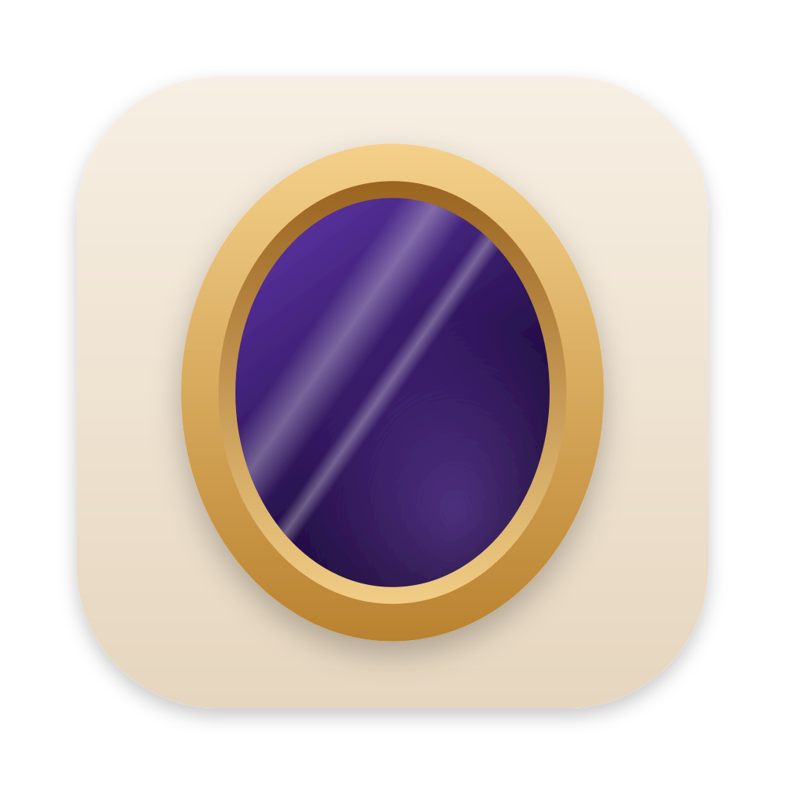

<p align="center"></p>

# Tezca

Self-hosted, live, end-to-end encrypted sync for Obsidian, with real-time collaboration in shared folders.

- **Live:** keystroke-level sync via Yjs CRDTs. Cursors of your other devices show up in open notes.
- **End-to-end encrypted:** the host stores and relays ciphertext only. It never sees paths, content or cursors.
- **Attachments:** images, PDFs and every other file sync too, encrypted, with earlier versions kept.
- **Shared folders:** share any folder with people on your host, on their own Tezca host, or with no host at all (they join yours as a guest). Live multiplayer editing with cursors, owner/editor/viewer roles, invite links, and key rotation when someone is removed.
- **Canvas and settings:** canvases merge concurrent edits per card; optionally sync Obsidian settings, themes, hotkeys and plugins between your devices.
- **History:** notes keep hourly and daily versions on the host; restore any version, or bring back deleted files.
- **Self-hosted:** a single small Go binary / Docker container with SQLite (attachments on disk or any S3-compatible store). Nothing else to run.

Status: **M5 (all planned milestones built)**. See [docs/plan.md](docs/plan.md).

## Repository

| Path | What |
|---|---|
| [`server/`](server/) | Go relay server ([README](server/README.md)) |
| [`plugin/`](plugin/) | Obsidian plugin (TypeScript) |
| [`proto/`](proto/) | Protobuf wire schema, codegen script and cross-language test vectors |
| [`sim/`](sim/) | Headless multi-client simulator against the real server |
| [`deploy/`](deploy/) | Dockerfile and compose recipes (plain HTTP, Caddy, Tailscale, Cloudflare Tunnel) |
| [`docs/`](docs/) | [research](docs/research.md), [plan](docs/plan.md), [protocol](docs/protocol.md) |

## Quick start (development)

```sh
pnpm install

# server
cd server && TEZCA_CLAIM_CODE=dev TEZCA_DATA_DIR=/tmp/tezca go run ./cmd/tezca-server
#   → open http://localhost:8080/claim?code=dev

# plugin
pnpm -C plugin build          # → plugin/main.js, manifest.json, styles.css
# copy those three files into <vault>/.obsidian/plugins/tezca-sync/ and enable "Tezca Sync"
```

Then, in Obsidian, either open the claim link from the claim page (`obsidian://tezca?do=claim…`), or paste it into **Settings → Tezca Sync → Set up with a link**. Save the recovery phrase. To add more devices, use **Pair another device** and scan the QR code.

Mobile devices need HTTPS. See [deploy/README.md](deploy/README.md).

## Tests

```sh
pnpm -C plugin test            # unit + integration tests against an in-memory mock host
(cd server && go test -race ./...)
pnpm sim -- --runs 5 --steps 200 --clients 4   # randomized multi-client simulation against the real server
```

`proto/gen.sh` regenerates protobuf code. `pnpm -C plugin vectors` regenerates the signature test vectors.

## Installing the plugin on other devices

Releases are published to GitHub with `just release <version>`. Install them with [BRAT](https://github.com/TfTHacker/obsidian42-brat): add the beta plugin `alexjsp/tezca-obsidian-sync` (no token needed). Then pair the device from **Settings → Tezca Sync → Pair another device** on one that's already set up.

The server is deployed to Unraid with `just deploy-unraid` (copy `.env.example` to `.env` first).

## License

[MIT](LICENSE)
