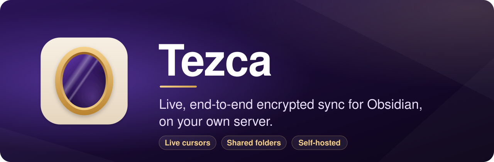

<p align="center"></p>

Tezca keeps your Obsidian vault in sync across your devices as you type, and lets you share folders that people edit together in real time. It runs on your own server, which only ever sees encrypted data.

- **Live:** changes appear on your other devices as you type, with cursors showing where everyone is.
- **End-to-end encrypted:** your server only ever stores encrypted data. It never sees your notes, file names or cursors.
- **Everything syncs:** notes, images, PDFs and any other files, plus (if you want) Obsidian's settings, themes, hotkeys and plugins.
- **Shared folders:** share any folder with family, friends or colleagues. They can edit with you live, as owners, editors or viewers, even if they don't run a server of their own.
- **History you can trust:** restore any note to any point in the last 30 days, bring back deleted files, and get a local safety copy whenever sync would remove a lot of a file.
- **Yours:** one small Docker container on your own hardware. Nothing else to run.

## Getting started

You need two things: the **Tezca server** running somewhere your devices can reach, and the **Tezca plugin** in Obsidian on each device.

### 1. Run the server

**On Unraid:** on the **Docker** tab, add `https://github.com/alexjsp/unraid-community-apps` under **Template repositories** and save. Then choose **Add Container**, pick **Tezca** from the template list, and set **Public URL** to the address your devices will use, for example `https://notes.example.com`. (Once Tezca is in Community Applications, you'll be able to install it from the **Apps** tab instead.)

**With Docker anywhere else:**

```sh
docker run -d --name tezca --restart unless-stopped \
  -p 8080:8080 -v tezca-data:/data \
  -e TEZCA_PUBLIC_URL=https://notes.example.com \
  ghcr.io/alexjsp/tezca-server:latest
```

Phones and tablets need **HTTPS**. Put the server behind your reverse proxy (Nginx Proxy Manager, Caddy, Traefik…) with WebSockets allowed, or use Tailscale or a Cloudflare Tunnel. [deploy/README.md](deploy/README.md) has ready-made setups for each.

### 2. Claim it

Open your server's address in a browser. While nobody has claimed it, the container's log shows a **claim link**: whoever opens it first becomes the server's admin, so do this straight away. On Unraid, click the Tezca icon and choose **Logs**; with Docker, run `docker logs tezca`.

### 3. Install the plugin

Tezca isn't in Obsidian's plugin directory yet, so it installs through BRAT:

1. In Obsidian, open **Settings → Community plugins**, turn community plugins on, choose **Browse**, and install and enable **BRAT**.
2. In BRAT's settings, choose **Add beta plugin** and enter `alexjsp/tezca-obsidian-sync`.
3. Turn on **Tezca Sync** under **Community plugins**.

This works on iPhone, iPad and Android too.

### 4. Connect your vault

Open the claim link on the device with your vault and press **Open in Obsidian**, or copy it into **Settings → Tezca Sync → Paste link**. Tezca shows your **recovery key** (`TZCA-…`): the only way back in if you lose all your devices. Save it in your password manager, or write it down.

### 5. Add your other devices

In **Settings → Tezca Sync**, press **Pair device** and scan the QR code with your phone's camera (or open the link on the other device). Pairing copies your identity across, so there's nothing else to type.

### 6. Share a folder

Right-click a folder and choose **Share folder…**, then create an invite link and send it. The other person opens it, follows the instructions on the page, and picks where the folder goes in their vault. To give someone their own private space on your server, use **Create invite** in Tezca's settings.

## Updating

- **Plugin:** BRAT updates its beta plugins when Obsidian starts. To update straight away, run BRAT's "check for updates" command from the command palette.
- **Server:** on Unraid, use **Check for updates** in the Docker tab. With Docker, `docker pull ghcr.io/alexjsp/tezca-server:latest` and recreate the container.

## Your data

- **Backups:** everything the server keeps is in its `/data` folder (`/mnt/user/appdata/tezca` on Unraid). It's all encrypted, so back it up like any other folder.
- **Recovery key:** without it, a server backup can't be decrypted. Keep it safe, and away from the server.
- **If something goes wrong:** open a note's **Version history** (right-click the file) to restore any point in the last 30 days, or run **Tezca Sync: Show recently deleted files** from the command palette. Before sync overwrites or removes a lot of a file, Tezca also keeps a copy in the hidden `.tezca-backup` folder of your vault for 30 days.

## Recovering without Obsidian

If you ever need your notes back without Obsidian or a running server, for example from a backup of the server's data folder, the standalone recovery script rebuilds everything as plain files. You need [Node.js](https://nodejs.org) 22.13 or newer, the server's data folder (`tezca.db` and `blobs/`), and your recovery key.

1. Download `tezca-recover.mjs` from the [latest release](https://github.com/alexjsp/tezca-obsidian-sync/releases/latest).
2. Stop the Tezca container (or copy its data folder somewhere first).
3. Run:

   ```sh
   node tezca-recover.mjs --data /mnt/user/appdata/tezca --out ~/Recovered
   ```

   It asks for your recovery key, then writes each of your synced vaults, with its shared folders, as ordinary Markdown files and attachments you can open in any editor (or as a new Obsidian vault). Add `--include-deleted` to also get back recently deleted files.

Everything is decrypted on your computer; nothing is sent anywhere. Plain shell tools can't do this on their own: the encryption (XChaCha20-Poly1305) and the way notes are stored (as edit histories) need the script. If your server keeps attachments in S3, copy the bucket's `blobs/` folder into the data folder first.

## Learn more

- [How deployment works](deploy/README.md): HTTPS options, reverse proxies, storing attachments in S3.
- [Server configuration](server/README.md): every setting.
- [Development](docs/development.md): building, testing and releasing Tezca.
- [Protocol](docs/protocol.md) and [design notes](docs/plan.md).

## License

[MIT](LICENSE)
